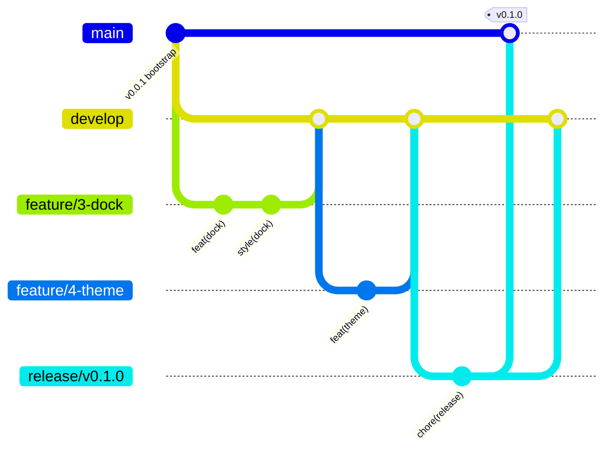

# Git workflow (Gitflow on GitHub)

Every change is: **issue → `feature/` branch off `develop` → small commits → PR into `develop` → CI green → merge**.
At the end of each phase, `develop` is released to `main` through a `release/` branch; a push to `main` deploys the site.

## Branches

| Branch | Created from | Merges into (by PR) | Lives | Deploys? |
|---|---|---|---|---|
| `main` | (initial commit) | — | forever | yes, every push (`deploy.yml`) |
| `develop` | `main` | — | forever, **default branch** | no (CI build only) |
| `feature/<issue#>-<slug>` | `develop` | `develop` | one issue | no |
| `release/v<X.Y.Z>` | `develop` | `main`, then `develop` | end of a phase | yes, on merge to `main` |
| `hotfix/v<X.Y.Z>-<slug>` | `main` | `main`, then `develop` | an urgent fix to the live site | yes |



`develop` is the default branch on purpose: GitHub closes an issue from `Closes #n` only when the PR merges into the
**default** branch, and new PRs target it automatically.

## Versions

| Point | Version |
|---|---|
| Phase 0 bootstrap (pushed straight to `main`) | `v0.0.1` |
| End of Phase N (1–6) | `v0.N.0` |
| End of Phase 8 (design refresh) | `v0.8.0` |
| End of Phase 7 (content filled, site complete) | `v1.0.0` |
| Hotfix | bump the patch: `v0.N.1` |

## One-time setup (end of Phase 0, after the first push to `main`)

1. `git switch -c develop && git push -u origin develop`, then `gh repo edit --default-branch develop`.
2. `gh repo edit --enable-merge-commit --enable-squash-merge --enable-rebase-merge=false`
   (squash title = PR title, message = commit messages). Feature and fix PRs are **squash-merged**, so each one lands on
   `develop` as a single Conventional Commit. Release and back-merge PRs use **merge commits**: squashing them would give
   `main` and `develop` different commits for the same change and break the next back-merge.
   Leave GitHub's "automatically delete head branches" **off**: it would delete a `release/` branch as soon as it merges
   into `main`, before the back-merge into `develop`. Feature branches are deleted by `gh pr merge --delete-branch` instead.
3. Labels: `type:feature`, `type:fix`, `type:style`, `type:docs`, `type:chore`, `type:ci`, `type:content`,
   `phase:0` … `phase:8`, `needs:owner` (`gh label create <name> --color <hex> --description <text>`).
4. Milestones, one per phase, with exactly these titles: `Phase 0: repository and deploy`, `Phase 1: shell`, `Phase 2: Home`,
   `Phase 3: Education + Experience`, `Phase 4: Research`, `Phase 5: Writing + Reading`, `Phase 6: SEO, a11y, QA`,
   `Phase 7: content fill`, `Phase 8: design refresh` (`gh api repos/UmmeKulsumTumpa/UmmeKulsumTumpa.github.io/milestones -f title="Phase 1: shell"`).
5. Issues: one per row of the **Issue backlog** below, with its labels and milestone and the body template.
6. Add `.github/workflows/ci.yml` through the normal feature loop for backlog issue 1 ("ci: build check on pull requests"): runs `npm ci` and `npm run build`
   on `pull_request` to `develop` and `main` and on `push` to `develop`. Use the current major versions of the actions
   (check their READMEs; do not guess) and Node from `.nvmrc`.
7. Branch protection on `main` and `develop`: changes only through PRs, the CI check must pass (branches need **not** be up to date with `develop`, so
   independent PRs merge without re-running CI; CI on `develop` after each merge catches a broken combination),
   no force-push, no deletion, **0 required approvals** (so you can merge your own PRs). Check the current GitHub REST docs for
   branch protection or rulesets before calling the API, then read the settings back with `gh api` to confirm.
8. `git tag v0.0.1 main && git push origin v0.0.1` and `gh release create v0.0.1 --title "v0.0.1 · bootstrap" --notes "Scaffold, spec, design reference, first deploy."`
9. Show the owner the milestones and issues as a table and wait for her OK before starting Phase 1.

## Issue body template

```md
## Goal
<one or two sentences: what the user sees when this is done>

## Spec
- SPEC §<n>: <section name>
- Screenshots to match: `docs/design/screenshots/<files>`

## Acceptance criteria
- [ ] <copied from the phase checks in docs/PLAN.md that apply to this issue>
- [ ] `npm run build` passes
- [ ] Visual check done (desktop dark, desktop light, mobile); differences listed in the PR

## Out of scope
<what this issue must not touch>
```

## Feature loop (one issue at a time)

1. `git switch develop && git pull --ff-only`
2. `git switch -c feature/<issue#>-<kebab-slug>` and `gh issue edit <issue#> --add-assignee @me`
3. Re-read the issue, the SPEC sections and the screenshots it names.
4. Work in small commits (rules below). `npm run build` must pass before every commit.
5. Visual check from `docs/PLAN.md`.
6. `git push -u origin HEAD`, then
   `gh pr create --base develop --title "<type>(<scope>): <summary>" --body-file <tmp>` with this body:
   `Closes #<issue#>` · what changed · acceptance-criteria results (pass/fail + evidence) · visual-check differences fixed and remaining.
7. `gh pr checks --watch`. If CI fails, fix with new commits (never amend pushed commits).
8. Review `gh pr diff` against `CLAUDE.md`: only what the issue asks, no inline styles, hex only in `tokens.css`,
   no stray files (`dist/`, `.shots/`, `node_modules/`). Code, CSS and config PRs get an independent review;
   content-only PRs (Markdown/YAML, images) are checked in the built HTML and screenshots instead. No auto-merge.
9. `gh pr merge <pr#> --squash --delete-branch`
10. `git switch develop && git pull --ff-only`; confirm the issue is closed. Post a one-line status to the owner and take the next issue.

Batch exception: when the owner asks for a single batch (Phase 8), one umbrella issue lists the rows as a checklist;
tracks work in local worktree branches merged into one `feature/<issue#>-<slug>` branch; one PR, squash-merged.

New work found mid-feature (a bug, an idea, missing content) becomes a **new issue**, not extra commits on the current branch.
Blocked on the owner (missing text, a decision): keep the `[placeholder]`, add `needs:owner` with a comment saying exactly what is needed, and continue with the next independent issue.

## Release loop (end of each phase)

1. All issues in the phase milestone are closed (or moved, with the owner's agreement). Pre-release checks scale with
   the change: a full review (code, accessibility, Lighthouse, visual at every width and theme) when code or CSS changed
   since the last release; Lighthouse on Home, a console sweep and one visual pass when only content changed.
2. `git switch develop && git pull --ff-only && git switch -c release/v0.N.0`
3. `npm version 0.N.0 --no-git-tag-version`, commit `chore(release): v0.N.0`, push.
4. `gh pr create --base main --title "release: v0.N.0 · Phase N: <name>"`; body lists the merged PRs and closed issues.
5. `gh pr checks --watch`, then **stop and ask the owner**: merging deploys the public site. Merge only after she says yes:
   `gh pr merge <pr#> --merge` (keep the branch for step 7).
6. `gh release create v0.N.0 --target main --title "v0.N.0 · Phase N: <name>" --generate-notes`
7. Back-merge: `gh pr create --base develop --head release/v0.N.0 --title "chore: back-merge v0.N.0 into develop"`, CI green,
   `gh pr merge <pr#> --merge --delete-branch`.
8. `gh run watch` on the deploy run; open https://ummekulsumtumpa.github.io and check every page that changed.
9. Close the milestone (`gh api -X PATCH repos/UmmeKulsumTumpa/UmmeKulsumTumpa.github.io/milestones/<n> -f state=closed`).

## Hotfix (live site broken)

Issue with `type:fix` → `hotfix/v0.N.1-<slug>` from `main` → fix → PR into `main` (ask the owner before merging) →
tag + release → PR the same branch into `develop`.

## Commits

Conventional Commits: `<type>(<scope>): <imperative summary>`, summary ≤ 72 characters, no trailing period.

| Type | For |
|---|---|
| `feat` | a new visible piece of the site |
| `fix` | a bug |
| `style` | CSS / visual-only change |
| `refactor` | code change with no visible change |
| `content` | Markdown/YAML content |
| `docs` | `docs/`, README, CLAUDE.md |
| `ci` / `build` / `chore` | workflows / dependencies, config / everything else |
| `perf`, `test` | performance / tests |

Scope is the component or page: `dock`, `theme`, `motion`, `page-head`, `home-hero`, `home-about`, `education`, `timeline`, `reading` …

Body (when the summary is not enough): why the change was made, then `Refs #<issue#>`.

Example:
```
feat(dock): add macOS-style magnification on hover

Hovered item scales 1.22x, neighbours 1.08x, per SPEC §3.3.
Tooltips are hidden under 520px where the dock has no hover.

Refs #3
```

One logical change per commit; every commit builds. Never: commit to `main`/`develop` directly (after Phase 0),
force-push a shared branch, rewrite pushed history, `--no-verify`, or commit secrets.

## Issue backlog

Create these at setup. Order inside a phase is the order to work them. Each row is one issue → one branch → one PR.

| # | Phase | Title | Type | SPEC | Screenshots |
|---|---|---|---|---|---|
| 1 | 0 | ci: build check on pull requests | ci | §2 | — |
| 2 | 1 | Base layout, tokens and shared background | feature | §2.1, §3.1, §3.2 | home-desktop-01, home-light-01 |
| 3 | 1 | Dock navigation | feature | §3.3 | dock in every shot, mobile-* |
| 4 | 1 | Theme toggle (no flash, persisted) | feature | §3.5 | home-light-01 |
| 5 | 1 | Motion system (entrances, stagger, parallax, reduced motion) | feature | §3.4 | (prototype in Play mode) |
| 6 | 1 | Page head component + route stubs for all pages | feature | §5 intro | *-desktop-01 |
| 7 | 1 | Footer, 404 page, favicon | feature | §5, §5.7 | home-desktop-07-footer |
| 8 | 2 | Home: hero with live clock | feature | §5.1 item 1 | home-desktop-01, mobile-home-01 |
| 9 | 2 | Home: About (approved layout) | feature | §5.1 item 2 | home-desktop-02/03/04, mobile-home-02 |
| 10 | 2 | Home: glimpse bento (list on phones) | feature | §5.1 item 3 | home-desktop-04/05, mobile-home-03 |
| 11 | 2 | Home: token strip and contact | feature | §5.1 items 4–5 | home-desktop-06/07, mobile-home-04 |
| 12 | 3 | Education: timeline | feature | §5.2 | education-desktop-01/02 |
| 13 | 3 | Education: course-project archive island | feature | §5.2 | education-desktop-03/04 |
| 14 | 3 | Education: hackathons, awards and activities | feature | §5.2 | education-desktop-05 |
| 15 | 3 | Experience: timeline | feature | §5.3 | experience-desktop-01/02/03 |
| 16 | 3 | Experience: selected projects and toolbox | feature | §5.3 | experience-desktop-04/05 |
| 17 | 4 | Research: interests and publications | feature | §5.4 | research-desktop-01/02 |
| 18 | 4 | Research: in progress, talks, collaborators | feature | §5.4 | research-desktop-03/04 |
| 19 | 5 | Writing: list, featured card, tag filter | feature | §5.5 | writing-desktop-01/02/03 |
| 20 | 5 | Writing: post page, previous/next, RSS | feature | §5.5 | — |
| 21 | 5 | Reading: library island (tabs, status, covers, rows) | feature | §5.6 | reading-*, mobile-reading-* |
| 22 | 5 | Reading: notes pages for entries with a body | feature | §5.6 | — |
| 23 | 6 | SEO: sitemap, robots, Open Graph, per-page meta | feature | §7 | — |
| 24 | 6 | Accessibility pass (keyboard, focus, contrast, landmarks) | fix | §6 | — |
| 25 | 6 | Performance pass (Lighthouse ≥ 95 on Home) | perf | §7, §8 | — |
| 26 | 6 | Responsive and theme QA at 1440 / 1024 / 390 | style | §6, §8 | all |
| 27 | 7 | Content: fill placeholders with the owner | content | §9 | — |

Issue numbers on GitHub will differ from the `#` column; always use the real number from `gh issue create`.
