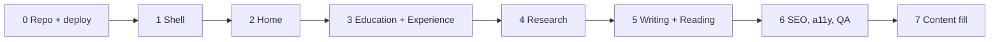

# Build plan

Execute one phase at a time, in order. A phase is done only when every check under it passes.
Git: each phase is a GitHub milestone whose issues are worked one at a time with the **feature loop** in
`docs/GIT-WORKFLOW.md` (issue → `feature/` branch off `develop` → commits → PR → CI → merge). A phase ends with the
**release loop** (`release/v0.N.0` → `main`, which deploys; the owner approves that merge). Phase 0 is the exception:
its first commit goes straight to `main` to create the repo, then it sets up `develop`, CI, labels, milestones, the
issue backlog and branch protection.

## Visual check (used by every phase from 1 on)

1. `npm run build && npm run preview` (serves http://localhost:4321).
2. In a second terminal: `npm run shots -- /<page>/` → `.shots/*.png`.
   First run only: `npx playwright install chromium` (or set `CHROMIUM_PATH` to an installed Chrome).
3. Read each `.shots/<page>-desktop-dark-NN.png` and the matching `docs/design/screenshots/<page>-desktop-NN.jpg`
   (index: `docs/design/README.md`). Write down every difference in layout, spacing, type size, colour, alignment
   or missing element. Fix, re-shoot, repeat until nothing worth naming is left.
4. Repeat for `mobile` and `light`.
5. Put the before/after list in the PR description.

---

## Phase 0: repository and deploy (on the owner's Mac)

Prerequisites (check, install only what is missing, ask before installing):

| Tool | Check | Install |
|---|---|---|
| Node ≥ 22.23.4 (24 recommended) | `node -v` | `brew install node@24` or `nvm install 24` |
| GitHub CLI, logged in as UmmeKulsumTumpa | `gh auth status` | `brew install gh` then `gh auth login` (the owner runs the login herself) |

Steps:

1. `git init -b main` (skip if `.git` exists).
2. `npm ci && npm run build` must pass.
3. `git add -A && git commit -m "chore: scaffold site, spec, design reference"`.
4. `gh repo create UmmeKulsumTumpa.github.io --public --source=. --remote=origin --push`
   (the repo name must be exactly `<username>.github.io` for the site to live at the root URL).
5. Enable Pages with GitHub Actions as the source:
   `gh api -X POST repos/UmmeKulsumTumpa/UmmeKulsumTumpa.github.io/pages -f build_type=workflow`
   (if it answers that Pages already exists, use `-X PUT` with the same field).
6. `gh run watch` until the "Deploy to GitHub Pages" run is green.
7. Run the one-time setup in `docs/GIT-WORKFLOW.md`: `develop` as default branch, merge settings, CI (the first feature PR),
   labels, milestones, the issue backlog, branch protection, tag `v0.0.1`. Show the owner the backlog and wait for her OK.

Checks: the Actions run is green; https://ummekulsumtumpa.github.io shows the placeholder line; `develop` is the default branch;
`main` and `develop` reject direct pushes and require the CI check; every backlog issue exists with its labels and milestone;
release `v0.0.1` exists.

## Phase 1: shell (layout, background, dock, theme, motion, page head, 404)

Move from the design-time drafts (formerly `docs/reference/`, removed after Phase 6): `Base.astro`, `Dock.astro`, `PageHead.astro`, `ThemeToggle.tsx`,
`LocalTime.tsx`, all `styles/`. Write `src/components/Footer.astro`, `src/pages/404.astro`, `public/favicon.svg`.
Create empty-but-valid stubs for the other routes (`education`, `experience`, `research`, `writing`, `reading`)
using `Base` + `PageHead` only, so the dock links work.

Checks:
- Background matches `home-desktop-01.jpg` and `home-light-01.jpg` (image + grain, no CSS blur glows).
- Dock: order, hover magnification, tooltip, active dot, Email hidden < 520px; matches the dock in every screenshot.
- Theme toggle persists across reloads with no flash of the wrong theme.
- Page heads on all stub pages match `*-desktop-01.jpg` (path line, § label, serif title, ghost word, lead).
- `prefers-reduced-motion` (DevTools → Rendering) turns off entrances and drift.
- No inline `style=""`, no `<style>` in pages, no hex colour outside `tokens.css`: `grep -rnE "#[0-9a-fA-F]{3,8}\b" src --include='*.css' | grep -v tokens.css` prints nothing.

## Phase 2: Home

Replace the placeholder `src/pages/index.astro`. Components in `src/components/home/`: Hero, About (both drafted in
reference), Glimpse, TokenStrip, Contact. Styles: `src/styles/pages/home.css`.

Checks: visual check against `home-desktop-01…07`, `home-light-01`, `mobile-home-01…04`. In particular:
- Name on one line at 1375px; two lines on phones.
- About layout exactly as approved: facts aside + text, then off-the-clock 2×2 + portrait (equal height), then full-width quote.
- Glimpse is a bento on desktop and a numbered list under 640px.
- Glimpse numbers come from collections (course-project count, latest post, current book), not hard-coded.

## Phase 3: Education + Experience

`Timeline.astro` (reference) fed by `src/content/education.yaml` / `experience.yaml`, newest first.
Course-project archive as a React island (`src/islands/ProjectArchive.tsx`) fed by `course-projects.yaml`.
Experience selected projects + toolbox. Hackathons and awards on Education.

Checks: visual check against `education-desktop-01…05` and `experience-desktop-01…05`
(do **not** copy the glitch in `experience-desktop-04-projects-GLITCH.jpg`; see SPEC §5.3).
Filter pill counts equal the YAML counts. Adding a role to the YAML adds it to the page with no code change.

## Phase 4: Research

Interests, publications from `publications.yaml`, in progress, talks, collaborators.

Checks: visual check against `research-desktop-01…04`; "U. K. Tumpa" is bold in the author list.

## Phase 5: Writing + Reading

Writing list with featured card and tag filter island, post page `src/pages/writing/[...slug].astro`, `/rss.xml`.
Reading library with tabs + status island, book covers, paper/article rows, optional `/reading/<slug>/` notes pages.
Add one sample post and one sample reading entry marked `draft: true` to prove the pipeline, then delete them.

Checks: visual check against `writing-desktop-01…03`, `reading-desktop-01…04`, `reading-light-01-papers`,
`mobile-reading-light-01…02`. Drafts do not appear in `npm run build` output. `/rss.xml` validates.

## Phase 6: SEO, accessibility, performance, QA

Sitemap (`@astrojs/sitemap`), `robots.txt`, Open Graph image, per-page titles/descriptions.
Run Lighthouse (Chrome DevTools, mobile) on every page; keyboard-only pass; both themes at 1440 / 1024 / 390.

Checks: Lighthouse ≥ 95 in all four categories on Home; no console errors; every page passes the visual check at all three widths.

## Phase 7: content fill (with the owner)

Walk through SPEC §9 with the owner and replace every `[placeholder]`. Add `public/portrait.jpg` and `public/cv.pdf` when she provides them.
