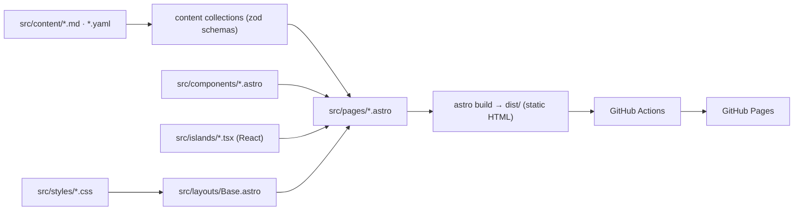

# Personal website: product & design spec

Owner: Umme Kulsum Tumpa · Repo: `UmmeKulsumTumpa.github.io` · Live URL: https://ummekulsumtumpa.github.io

This is the source of truth for what to build. `docs/PLAN.md` says in what order.
The approved visual design lives in two places:

- **Interactive prototype (canonical):** the "Personal Website" Design artifact on claude.ai
  (https://claude.ai/artifact/MesRiVNsMdLZuuYKj2LPCa — private to the owner; open it in Play to see motion).
- **Screenshots (in repo, open these first):** `docs/design/screenshots/*.jpg` — 36 captures of the
  approved prototype at 1375×732 (desktop) and phone width, dark and light. Index and notes:
  `docs/design/README.md`. **The built site must match these screenshots** (layout, spacing, type
  scale, colour); use them as the visual acceptance test for every page.
- **v2 screenshots (Phase 8 design refresh):** `docs/design/screenshots/v2/*.jpg`, 1440×900, dark. They replace the v1
  captures for Home, Education, Experience and Research. v1 still applies to Writing, Reading, 404, phones and the light theme.
- **Prototype source (in repo):** `docs/design/*.dc.html` — one file per page. They run on the
  prototype runtime, so read them as markup/style reference (exact text, sizes, colours), not as code to copy verbatim.

If this spec and the prototype disagree, **this spec wins**; ask the owner when unsure.

---

## 1. Goals

| Goal | Measure |
|---|---|
| Show who she is in one glance (engineer + LLM researcher, personality) | Home answers "who / what / where to look next" above the fold |
| A lifetime CV she keeps adding to | New post / job / book = one Markdown or YAML file, no layout edits |
| Minimal, calm, professional; motion like slide entrances | No bright colours; motion is subtle and respects reduced-motion |
| Free hosting | GitHub Pages via Actions |
| Fast & accessible | Lighthouse ≥ 95 (perf, a11y, best practices, SEO) on Home |

Non-goals: CMS, comments, analytics (can be added later), server code.

## 2. Stack & architecture

| Layer | Choice | Notes |
|---|---|---|
| Framework | **Astro 7** (static output) | Node ≥ 22.23.4 (CI uses 24) |
| Interactivity | **React 19 islands** via `@astrojs/react` | Only for: theme toggle, local clock, list filters/tabs |
| Language | TypeScript (strict) | |
| Content | Astro content collections (`src/content.config.ts`) | Markdown for prose, YAML for lists |
| Motion | `src/scripts/motion.ts` (IntersectionObserver) + `src/styles/motion.css` | No animation library needed; `motion` (motion.dev) allowed later |
| Hosting | GitHub Pages, `.github/workflows/deploy.yml` | Pages source must be "GitHub Actions" |



### 2.1 Folder structure and separation of concerns (mandatory)

```
src/
  pages/        routes only; compose components; no <style>, no inline style=""
  layouts/      Base.astro: <head>, background, dock, motion script
  components/   *.astro, markup only (props in, HTML out); no inline styles/scripts
    home/       Hero, News, SiteIndex, IconLinks, TokenStrip
  islands/      *.tsx React components that need client JS; nothing else
  scripts/      *.ts browser behaviour (motion.ts); no DOM building
  styles/
    tokens.css         colours, fonts, spacing, radii (only place hex values live)
    base.css           reset + element defaults
    utilities.css      .container .label .chip .card .btn .pill-btn …
    motion.css         [data-anim] states, stagger classes .d1–.d8
    components/*.css   one file per component (dock.css, timeline.css, …)
    pages/*.css        one file per page (home.css, education.css, …)
    global.css         @import manifest only
  content/      all text & data (see §4)
  data/site.ts  name, links, nav order
public/         bg/ (background images), grain.webp, favicon.svg, cv.pdf, og image (portrait: src/assets/portrait.jpg)
docs/           SPEC.md, PLAN.md, GIT-WORKFLOW.md, design/
```

Rules: class names are kebab-case and scoped by component prefix (`.tl-*`, `.dock-*`, `.about-*`).
No colour literals outside `tokens.css`.
No `!important`. No CSS-in-JS. Islands use the same global classes.

The draft components written during design (formerly `docs/reference/`) were moved into `src/` in Phase 1 and removed
after Phase 6; `src/` is the implementation.

## 3. Design system

### 3.1 Tokens (already in `src/styles/tokens.css`)

| Token | Dark (default) | Light |
|---|---|---|
| `--bg` | `#0b0c0f` | `#f7f7f8` |
| `--surface` | `#121418` | `#eeeef1` |
| `--border` | `#22252c` | `#dedee3` |
| `--pill-border` | `#3c3f48` (inactive pills and status chips) | `#c3c3cb` |
| `--text` | `#ececef` | `#131418` |
| `--muted` | `#a3a6b0` | `#4b4d56` |
| `--faint` | `#9597a0` (6.7:1 on bg) | `#5d5f69` (5.9:1) |
| `--accent` | `#b9a6ff` | `#5b32d6` |

Fonts (self-hosted with Astro's Fonts API, Google Fonts files): **Instrument Serif** (display: name, page titles, section titles, big numbers),
**IBM Plex Sans** (body), **IBM Plex Mono** (labels, meta, code). Labels are mono 11–12px, letter-spacing 0.08em.
Container max-width 1280px, gutter 32px (20px under 640px). Card radius 16px; tiles 14–22px.

### 3.2 Background (same on every page)

The owner explicitly approved this background: keep it identical across pages.

Fixed layer behind all content, built from pre-rendered high-resolution images (already in the repo):

| File | Size | Use |
|---|---|---|
| `public/bg/background-dark.avif` / `.webp` | 3840×2400 | dark theme, ≥1101px |
| `public/bg/background-dark-1920.webp` | 1920×1200 | dark theme, ≤1100px |
| `public/bg/background-light.avif` / `.webp` | 3840×2400 | light theme, ≥1101px |
| `public/bg/background-light-1920.webp` | 1920×1200 | light theme, ≤1100px |
| `public/grain.webp` | 128px tile, lossless | film grain overlay, opacity 0.6, both themes |

The images bake in the three glows of the prototype (violet `#7c6bff` top-left, slate `#3e5c8f` right,
deep violet `#5b4fa8` bottom; dark opacity ≈ 0.30, light ≈ 0.16) on the page colour, so no CSS blur is needed.
Layers back to front: `body` background `var(--bg)` → `.bg-image` (`background-size: cover`, `image-set()` AVIF→WebP,
slow 40s drift of 2% translate + 4% scale) → `.grain`. Drift stops under `prefers-reduced-motion`.
Implementation: `src/styles/components/background.css` + `src/layouts/Base.astro`.
Compare against `docs/design/screenshots/home-desktop-01.jpg` (dark) and `home-light-01.jpg` (light).

### 3.3 Dock (navigation)

Floating glass pill, bottom-centre, fixed. Order: **Home, Education, Experience, Research, Writing, Reading** | Email, Theme.
macOS-style hover magnification (hovered 1.22×, neighbours 1.08×), tooltip label above, active page gets a dot + tint, `aria-current="page"`.
Hover effects apply only on devices that hover (`@media (hover: hover)`), so one tap navigates on touch screens; keyboard focus keeps them.
Under 520px: 42px items, no tooltips, Email hidden. On touch screens an item shrinks to 0.92× while pressed (off under reduced motion). Slides up on load. No top nav bar anywhere.

### 3.4 Motion vocabulary

Slide-style entrances when elements enter the viewport: `up`, `from-left`, `from-right`,
`zoom`, `blur`, `mask` (line wipe for big headings), on every page: page heads, section heads, timeline orgs and roles,
list rows, cards. Entrances replay in both scroll directions:

- Scrolling down, an element that comes in at the bottom of the viewport enters from below (as on first load).
- Scrolling up, an element that comes in at the top enters from above: the vertical offset of `up`, `blur` and the
  `mask` wipe is mirrored. `from-left`, `from-right` and `zoom` look the same either way.
- An element enters once about 12% of it is visible and resets to hidden only when it is fully out of the viewport
  (hysteresis, so nothing flickers at the edge). The reset jumps without a transition, so it plays again the next time
  it enters, from whichever side that is.

First-screen content enters from below on load. Stagger with `.d1`–`.d8`. Light parallax (`data-parallax`) only on
elements that carry it; the ghost words and the hero dot grid are gone. Hydrated island copies of entered elements carry
on without replaying. Everything off under reduced motion; content must be fully visible with JS disabled (the hidden
state only applies once `html[data-anim-ready]` is set, and the head script in `Base.astro` shows everything if
`motion.ts` never starts).

### 3.5 Theme

Dark default. Toggle in dock (React island) sets `html[data-theme]` and saves to `localStorage`; an inline head
script applies the saved theme before paint (no flash).

## 4. Content model (already defined in `src/content.config.ts`)

| Collection | Source | Shape |
|---|---|---|
| `writing` | `src/content/writing/*.md` | title, date, summary, tags[llm/engineering/notes/essays], featured, draft |
| `reading` | `src/content/reading/*.md` | title, author, kind[book/paper/article], status[reading/finished/queued], topic?, year?, finished? (date), url?, why? (+ Markdown notes) |
| `experience` | `src/content/experience.yaml` | org entries with `roles[]` (title, type, start, end, current, summary, bullets) |
| `education` | `src/content/education.yaml` | same shape; roles = degrees (+ details[], courses[], progress? = thesis progress in % for the Home education tile) |
| `projects` | `src/content/course-projects.yaml` | id = GitHub repo name, category[spl/ai/sys/fund], lang, desc, course, featured (default false; shown as a card on Education), title? (display title; else the id) |
| `news` | `src/content/news.yaml` | Home News list, newest first: id, date (as shown, e.g. "Jul 2026"), text, href? (page the row links to) |
| `publications` | `src/content/publications.yaml` | title, authors[], venue, year, tldr, links[], short?, venueShort? (shorter title and venue for the Home research tile) |
| `selectedProjects` | `src/content/selected-projects.yaml` | Experience project cards: id, title, href, meta?, line[] (text, or { text, href } links inside the line), stack |
| `toolbox` | `src/content/toolbox.yaml` | Experience toolbox columns, in page order: id, name, items[] |
| `certifications` | `src/content/certifications.yaml` | Education certifications: id, title, issuer, date (as shown, e.g. "Dec 2024"), note?, image (certificate in `src/assets/certificates/`), alt, url? (verification page) |

Files starting with `_` are templates and are ignored. YAML lists are **newest first**; the first role inside an
org is the newest. `[Bracketed text]` is placeholder content the owner will fill in. Keep it in the content files and never
invent replacements. **Production builds hide placeholders; `npm run dev` shows them**, so the owner can see what is missing:

- an item whose whole text is a placeholder is not rendered;
- a placeholder inside a string is removed together with its neighbouring separator (` · `, ` → `);
- a section whose items are all placeholders is not rendered.

One frame stays on purpose, without its bracket text in production: the project screenshot frame on Experience.
Components use the helper in `src/lib/placeholder.ts`; no ad-hoc regexes.

## 5. Pages

All pages: `Base` layout, shared background, dock, footer (© year · last updated · "hosted on GitHub Pages" · top ↑),
bottom padding ≥ 150px so the dock never covers the last line. On pages shorter than the viewport (the 404) the footer
sits at the bottom of the viewport.

Page heads (every page but Home): terminal breadcrumb `~/ummekulsumtumpa/<page>` (mono 12px, `--faint`), serif title
`clamp(48px, 7vw, 72px)`, lead. No ghost word and no `§ <slug>` label. At 1440×900 the head is about 240px tall.

### 5.1 Home `/` (screenshots `v2/home-after-view`, `v2/home-after-full`; phones and light theme: `mobile-home-01…04`, `home-light-01`)

Order: Hero → News → "around the site" → Token strip. No About, off-the-clock tiles, quote, bento or "Say hello." section
(the hero's icon links and the dock's email cover contact).

1. **Hero:** top line `~/ummekulsumtumpa` + "Dhaka, BD · HH:MM (UTC+6)" live clock island (12px); "hello, I'm" (mono, accent);
   **name on one line**, Instrument Serif, `clamp(52px, 7.2vw, 104px)`, blinking accent caret; "SOFTWARE ENGINEER · RESEARCHER"
   tracked mono; bio (`site.bio`, named entities in `--text`); italic serif statement; icon links (Google Scholar
   first and accented, then email, GitHub, LinkedIn, CV), each with an `aria-label` and a dock-style tooltip on hover/focus (none on touch).
   **Portrait** on the right (4:5, `src/assets/portrait.jpg` through Astro `<Image>`, caption "Umme Kulsum Tumpa · Dhaka, 2026").
   No ghost word, no dot grid, no "currently" block. On phones (≤640px) the top line keeps the full `~/ummekulsumtumpa`
   (like the other pages' breadcrumb) with "Dhaka · HH:MM".
2. **News:** from `news.yaml`, newest first. Label `news` in the left rail; rows of date (mono) and text; a row links to `href` when set.
3. **Around the site:** an index list, one row per page in dock order (Education, Experience, Research, Writing, Reading).
   Row = number, serif title, one live line, arrow; the whole row is one link. Live lines:
   Education "M.Sc. in Software Engineering, in progress" + thesis progress bar (value from `progress` in `education.yaml`);
   Experience the current role · org from `experience.yaml`; Research "Newest: " + newest `publications.yaml` entry
   (`short` / `venueShort` when set, else title / venue); Writing the latest post or "First post coming soon";
   Reading the current read (first book with `status: reading`, else the first entry of any kind with it) or "What's on my desk".
4. **Token strip:** "fig. 0 — me, tokenized": two rows of tokenizer-style chips sliding in opposite directions; keywords in accent.

Phones: the same order in a single column (name on two lines, portrait after the icon links, the index as a numbered list).

### 5.2 Education `/education/` (screenshots `v2/edu-after-full`, `v2/edu-after-arc`, `v2/edu-after-open`)

Page head (§5 intro). **Timeline, newest first, connected dots for the same institution:**
IIT DU [M.Sc. (current, thesis, supervisor, semester-1 course cards) → B.Sc. (CGPA, capstone, link to the course projects)] → HSC → SSC.
At ≥ 900px the timeline has a **date rail**: a ~200px left column with the dates and org meta; org logos are hidden at that width.
Below 900px the timeline keeps its single-column layout.
Then **course projects** (static, no island, no filter pills): head "Selected course projects" with the counts
(computed from the collection, e.g. "6 selected of 19"); the `featured` projects as cards (3 columns × 2 rows desktop, 2 at ≤ 900px, 1 on phones),
each linking to `https://github.com/UmmeKulsumTumpa/<id>`; under them a `<details>` "Show all N course projects" with every
project grouped by category (project lab, AI & ML, systems & SE, fundamentals), and an "all repositories on GitHub ↗" link.
Then hackathons & contests (Code Samurai 2024, Cosmo Scope AI, KC Fest; links in prototype) and awards & activities;
a section whose items are all placeholders is hidden (§4), and the other section takes the full row.
Then **05 · certifications**, a full-width list in the same row style: per certificate a thumbnail (Astro `<Image>`)
that links to the full-size image, title · issuer, an optional one-line note, and the date in the meta column.

### 5.3 Experience `/experience/` (screenshots `v2/exp-after-view`, `v2/exp-after-full`)

Page head (§5 intro). Timeline newest first, with the same date rail as Education (§5.2): Cefalo [Associate Software Engineer I (current, full-time) → Software Engineering Trainee (part-time) → Software Engineer Trainee (academic internship)], Fellowship.AI, BARTA Research Lab.
Then selected projects (image cards with zoom) and toolbox (Web, Mobile, Research, Practice). Projects whose title is a
placeholder are hidden (§4); toolbox items that are placeholders are dropped, and an empty column with them.
**Known prototype glitch:** in `experience-desktop-04-projects-GLITCH.jpg` the Cefalo Travel Connect text floats in the right column with
stray boxes. Do not copy that. With two or more projects, every project card is one card: screenshot (fixed 240px tall, as in `Experience.dc.html`) on top, then meta line, title ↗, one line, stack;
two cards per row on desktop, one on phones. **A single project renders as one wide card**: media left (screenshot frame, 240px),
text right, vertically centred; on phones it stacks with the media on top.

### 5.4 Research `/research/` (screenshot `v2/res-after-full`)

Page head (§5 intro). Interests (3 columns; the `asking:` line hidden while it is a placeholder), publications from collection
(year column + body: title, authors with "U. K. Tumpa" bold, venue italic serif, TL;DR, link pills for the links that exist).
No figure frame until a figure exists; TL;DR hidden while it is a placeholder. In progress (thesis; Bangla agents + WorkBench-bangla link),
talks & posters (hidden while every talk is a placeholder; collaborators then take the full row), collaborators (from Scholar co-authors).

### 5.5 Writing `/writing/` and `/writing/<slug>/` (`Writing.dc.html`; screenshots `writing-desktop-01…03`)

List: featured post card (first `featured: true`), tag filter pills (React island; on phones one horizontally scrolling row), rows with date, title, summary, tag, reading
time (words / 220, rounded up). Drafts are hidden in production builds. Empty state when no posts. Post page uses `.prose`
styles, back link, date, tags, reading time, previous/next. Add `/rss.xml` (`@astrojs/rss`).

### 5.6 Reading `/reading/` (`Reading.dc.html`, mobile: `MobileReading.dc.html`; screenshots `reading-desktop-01…04`, `reading-light-01-papers`, `mobile-reading-light-01…02`)

Page head (§5 intro), counts (books in <year>, papers read, notes written, all computed; "books in <year>" counts books whose
`finished` date is in the current year). React island: tabs Books / Papers / Articles, status pills all / reading / finished / queued.
Books render as covers (2:3, spine edge, rule below the title, accent on "reading"); papers/articles as rows with year, title
(links to the entry's `url` when it has one), source, italic "why", status, "notes →" (links to `/reading/<slug>/` when
the entry has a body).
On phones (≤640px) the head follows `MobileReading.dc.html`: crumb "← ~/reading", the one-line lead "Books, papers and articles:
reading, read, or next." and two counters (no "notes written"). Other pages keep their desktop head copy on phones.

### 5.7 404

On-brand: serif "Lost in context.", link home, dock.

## 6. Responsive & accessibility

- Breakpoints by content, mainly 520 / 640 / 900 / 1280. Mobile reference: `docs/design/MobileHome.dc.html`, `MobileReading.dc.html`.
- Name stays one line on desktop and never overflows its column (capped at 104px); two lines allowed on phones.
- Section gaps come from one token, `--section-gap`: 96px on desktop, 64px on phones (< 640px).
- Semantic landmarks (`header`, `main`, `nav`, `section` with `aria-labelledby`, `footer`), one `h1` per page.
- Contrast AA in both themes; visible focus ring; all interactive controls are real `<a>`/`<button>`; touch targets ≥ 44px on mobile.
- `prefers-reduced-motion`: no entrance motion, no parallax, no background drift, no caret blink.

## 7. Performance & SEO

- Ship zero JS except islands + `motion.ts`; islands use `client:visible` / `client:idle` (theme toggle `client:load`).
- Fonts: self-hosted with Astro's Fonts API (Google Fonts files), `display: swap`, preloaded. Images: Astro `<Image>` for portrait/screenshots.
- `<title>`, meta description, canonical, Open Graph per page; `@astrojs/sitemap`; `robots.txt`; favicon.svg.

## 8. Acceptance (whole site)

- `npm run build` passes with no type or content-schema errors.
- Every page matches the prototype layout at 1440, 1024 and 390 widths in both themes. Check by taking Playwright screenshots
  at 1375×732 and 390×844 and comparing them side by side with `docs/design/screenshots/` (see `docs/PLAN.md` → Visual check).
  Home, Education, Experience and Research compare at 1440×900 against `docs/design/screenshots/v2/`; their phone and
  light-theme checks still use the v1 captures.
- Adding `src/content/writing/my-post.md` and pushing to `main` publishes it with no code changes.
- Lighthouse ≥ 95 on Home (mobile).

## 9. Open content (owner to fill)

cv.pdf (a personal CV, owner to prepare), Fellowship.AI location, interest one-liners, paper PDF, course names and
one-liners per repo, awards & activities, current book, first posts and reading list.
