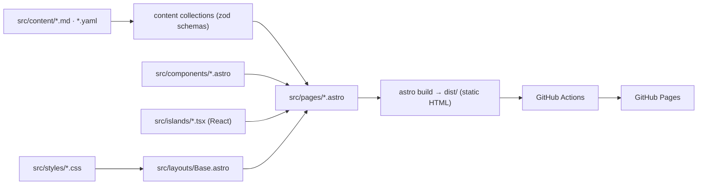

# Personal website: product & design spec

Owner: Umme Kulsum Tumpa · Repo: `UmmeKulsumTumpa.github.io` · Live URL: https://ummekulsumtumpa.github.io

This is the source of truth for what to build. `docs/PLAN.md` says in what order.
The approved visual design lives in two places:

- **Interactive prototype (canonical):** the "Personal Website" Design artifact on claude.ai
  (https://claude.ai/artifact/MesRiVNsMdLZuuYKj2LPCa — private to the owner; open it in Play to see motion).
- **Screenshots (in repo, open these first):** `docs/design/screenshots/*.jpg` — 36 captures of the
  approved prototype at 1375×732 (desktop) and phone width, dark and light. Index and notes:
  `docs/design/README.md`. **The built site must match these screenshots** (layout, spacing, type
  scale, colour); use them as the visual acceptance test for every page.
- **Prototype source (in repo):** `docs/design/*.dc.html` — one file per page. They run on the
  prototype runtime, so read them as markup/style reference (exact text, sizes, colours), not as code to copy verbatim.

If this spec and the prototype disagree, **this spec wins**; ask the owner when unsure.

---

## 1. Goals

| Goal | Measure |
|---|---|
| Show who she is in one glance (engineer + LLM researcher, personality) | Home answers "who / what / where to look next" above the fold |
| A lifetime CV she keeps adding to | New post / job / book = one Markdown or YAML file, no layout edits |
| Minimal, calm, professional; motion like slide entrances | No bright colours; motion is subtle and respects reduced-motion |
| Free hosting | GitHub Pages via Actions |
| Fast & accessible | Lighthouse ≥ 95 (perf, a11y, best practices, SEO) on Home |

Non-goals: CMS, comments, analytics (can be added later), server code.

## 2. Stack & architecture

| Layer | Choice | Notes |
|---|---|---|
| Framework | **Astro 7** (static output) | Node ≥ 22.23.4 (CI uses 24) |
| Interactivity | **React 19 islands** via `@astrojs/react` | Only for: theme toggle, local clock, list filters/tabs |
| Language | TypeScript (strict) | |
| Content | Astro content collections (`src/content.config.ts`) | Markdown for prose, YAML for lists |
| Motion | `src/scripts/motion.ts` (IntersectionObserver) + `src/styles/motion.css` | No animation library needed; `motion` (motion.dev) allowed later |
| Hosting | GitHub Pages, `.github/workflows/deploy.yml` | Pages source must be "GitHub Actions" |



### 2.1 Folder structure and separation of concerns (mandatory)

```
src/
  pages/        routes only; compose components; no <style>, no inline style=""
  layouts/      Base.astro: <head>, background, dock, motion script
  components/   *.astro, markup only (props in, HTML out); no inline styles/scripts
    home/       Hero, About, Glimpse, TokenStrip, Contact
  islands/      *.tsx React components that need client JS; nothing else
  scripts/      *.ts browser behaviour (motion.ts); no DOM building
  styles/
    tokens.css         colours, fonts, spacing, radii (only place hex values live)
    base.css           reset + element defaults
    utilities.css      .container .label .chip .card .btn .pill-btn …
    motion.css         [data-anim] states, stagger classes .d1–.d8
    components/*.css   one file per component (dock.css, timeline.css, …)
    pages/*.css        one file per page (home.css, education.css, …)
    global.css         @import manifest only
  content/      all text & data (see §4)
  data/site.ts  name, links, nav order
public/         bg/ (background images), grain.webp, favicon.svg, portrait, cv.pdf, og image
docs/           SPEC.md, PLAN.md, design/, reference/
```

Rules: class names are kebab-case and scoped by component prefix (`.tl-*`, `.dock-*`, `.about-*`).
No colour literals outside `tokens.css`.
No `!important`. No CSS-in-JS. Islands use the same global classes.

`docs/reference/` holds draft components written during design (Dock, Timeline, PageHead, Hero, About,
ThemeToggle, LocalTime, Base layout, and CSS). Reuse them as a starting point, but check them against this spec.

## 3. Design system

### 3.1 Tokens (already in `src/styles/tokens.css`)

| Token | Dark (default) | Light |
|---|---|---|
| `--bg` | `#0b0c0f` | `#f7f7f8` |
| `--surface` | `#121418` | `#eeeef1` |
| `--border` | `#22252c` | `#dedee3` |
| `--text` | `#ececef` | `#131418` |
| `--muted` | `#a3a6b0` | `#4b4d56` |
| `--faint` | `#82858f` (5.1:1 on bg) | `#666873` (5.3:1) |
| `--accent` | `#b9a6ff` | `#5b32d6` |

Fonts (self-hosted with Astro's Fonts API, Google Fonts files): **Instrument Serif** (display: name, page titles, section titles, big numbers),
**IBM Plex Sans** (body), **IBM Plex Mono** (labels, meta, code). Labels are mono 11–12px, letter-spacing 0.08em.
Container max-width 1280px, gutter 32px (20px under 640px). Card radius 16px; tiles 14–22px.

### 3.2 Background (same on every page)

The owner explicitly approved this background: keep it identical across pages.

Fixed layer behind all content, built from pre-rendered high-resolution images (already in the repo):

| File | Size | Use |
|---|---|---|
| `public/bg/background-dark.avif` / `.webp` | 3840×2400 | dark theme, ≥1101px |
| `public/bg/background-dark-1920.webp` | 1920×1200 | dark theme, ≤1100px |
| `public/bg/background-light.avif` / `.webp` | 3840×2400 | light theme, ≥1101px |
| `public/bg/background-light-1920.webp` | 1920×1200 | light theme, ≤1100px |
| `public/grain.webp` | 128px tile, lossless | film grain overlay, opacity 0.6, both themes |

The images bake in the three glows of the prototype (violet `#7c6bff` top-left, slate `#3e5c8f` right,
deep violet `#5b4fa8` bottom; dark opacity ≈ 0.30, light ≈ 0.16) on the page colour, so no CSS blur is needed.
Layers back to front: `body` background `var(--bg)` → `.bg-image` (`background-size: cover`, `image-set()` AVIF→WebP,
slow 40s drift of 2% translate + 4% scale) → `.grain`. Drift stops under `prefers-reduced-motion`.
Reference implementation: `docs/reference/styles/components/background.css` + `docs/reference/layouts/Base.astro`.
Compare against `docs/design/screenshots/home-desktop-01.jpg` (dark) and `home-light-01.jpg` (light).

### 3.3 Dock (navigation)

Floating glass pill, bottom-centre, fixed. Order: **Home, Education, Experience, Research, Writing, Reading** | Email, Theme.
macOS-style hover magnification (hovered 1.22×, neighbours 1.08×), tooltip label above, active page gets a dot + tint, `aria-current="page"`.
Under 520px: 42px items, no tooltips, Email hidden. On touch screens an item shrinks to 0.92× while pressed (off under reduced motion). Slides up on load. No top nav bar anywhere.

### 3.4 Motion vocabulary

Slide-style entrances when elements enter the viewport, replaying when scrolled back: `up`, `from-left`, `from-right`,
`zoom`, `blur`, `mask` (line wipe for big headings). Stagger with `.d1`–`.d8`. Parallax: only the faint dot grid and
the big outlined "ghost" word in headers (`data-parallax="0.3–0.45"`). Everything off under reduced motion; content
must be fully visible with JS disabled (the hidden state only applies once `html[data-anim-ready]` is set).

### 3.5 Theme

Dark default. Toggle in dock (React island) sets `html[data-theme]` and saves to `localStorage`; an inline head
script applies the saved theme before paint (no flash).

## 4. Content model (already defined in `src/content.config.ts`)

| Collection | Source | Shape |
|---|---|---|
| `writing` | `src/content/writing/*.md` | title, date, summary, tags[llm/engineering/notes/essays], featured, draft |
| `reading` | `src/content/reading/*.md` | title, author, kind[book/paper/article], status[reading/finished/queued], topic?, year?, url?, why? (+ Markdown notes) |
| `experience` | `src/content/experience.yaml` | org entries with `roles[]` (title, type, start, end, current, summary, bullets) |
| `education` | `src/content/education.yaml` | same shape; roles = degrees (+ details[], courses[]) |
| `projects` | `src/content/course-projects.yaml` | id = GitHub repo name, category[spl/ai/sys/fund], lang, desc, course |
| `publications` | `src/content/publications.yaml` | title, authors[], venue, year, tldr, links[] |

Files starting with `_` are templates and are ignored. YAML lists are **newest first**; the first role inside an
org is the newest. `[Bracketed text]` is placeholder content the owner will fill in. Render it as-is; never invent replacements.

## 5. Pages

All pages: `Base` layout, shared background, dock, footer (© year · last updated · "hosted on GitHub Pages" · top ↑),
bottom padding ≥ 150px so the dock never covers the last line.

### 5.1 Home `/` (prototype: `docs/design/Main.dc.html`; screenshots `home-desktop-01…07`, `home-light-01`, `mobile-home-01…04`)

1. **Hero:** top line `~/ummekulsumtumpa` + "Dhaka, BD · HH:MM (UTC+6)" live clock island; "hello, I'm" (mono, accent);
   **name on one line**, Instrument Serif, `clamp(52px, 11.4vw, 163px)` (the cap keeps name + caret inside the 1280px container at any width), blinking accent caret; "SOFTWARE ENGINEER · RESEARCHER"
   tracked mono; italic serif statement (left) + "currently" block with pulsing dot (right). Faint dot grid + outlined
   "context" ghost word with parallax.
2. **About (§ 01):** heading "A little about me." on one line + `~/about.md · engineer · researcher · reader`.
   - Row: left `aside` (at-a-glance facts list, then "find me" links: email, scholar, github, linkedin, cv.pdf) and right the text:
     lead sentence (22px) + three paragraphs (17px, single column). **This layout is approved; do not restructure it.**
   - Row: **off the clock** (2×2 tiles: History, Philosophy, Books, Learning: index top-right, serif word, one-line note)
     on the left, **portrait** (4:5, placeholder until `public/portrait.jpg` exists, caption "Umme Kulsum Tumpa · Dhaka, 2026") on the right; equal height.
   - Row: full-width italic serif quote "Working with LLMs as both a researcher and an engineer…" with caption "— why I do both".
3. **Glimpse (§ 02):** bento tiles linking to pages, in dock order: Education (M.Sc. + thesis progress bar), Experience
   ("4 production projects", stack chips), Research (paper title + "now → Bangla agents"), By the numbers
   (2 degrees, 1 paper, N course projects, where N comes from the collection), Writing (latest post or "first post coming soon"),
   Reading (current book from `status: reading` + spines). Hover: lift + ring, arrow rotates.
   **On phones (<640px) the bento becomes a numbered list** (`01 Education → … 05 Reading`, serif title, one-line note, arrow), see `mobile-home-03.jpg`.
4. **Token strip:** "fig. 0 — me, tokenized": two rows of tokenizer-style chips sliding in opposite directions; keywords in accent.
5. **Contact:** "Say hello." (mask) + email button + links.

### 5.2 Education `/education/` (`Education.dc.html`; screenshots `education-desktop-01…05`)

Header (ghost word "learning", italic). **Timeline, newest first, connected dots for the same institution:**
IIT DU [M.Sc. (current, thesis, supervisor, semester-1 course cards) → B.Sc. (CGPA, capstone, link to archive)] → HSC → SSC.
Then **Course projects** archive: React island with filter pills (all / project labs / AI & ML / systems & SE / fundamentals, with counts),
responsive card grid, each card links to `https://github.com/UmmeKulsumTumpa/<id>`. Then hackathons & contests
(Code Samurai 2024, Cosmo Scope AI, KC Fest; links in prototype) and awards & activities (placeholders).

### 5.3 Experience `/experience/` (`Experience.dc.html`; screenshots `experience-desktop-01…05`)

Header (ghost "ship it"). Timeline newest first: Cefalo [Associate SE (current, full-time) → SE part-time → Intern], Fellowship.AI, BARTA Research Lab.
Then selected projects (Cefalo Travel Connect + placeholders, image cards with zoom) and toolbox (Web, Mobile, Research, Practice).
**Known prototype glitch:** in `experience-desktop-04-projects-GLITCH.jpg` the Cefalo Travel Connect text floats in the right column with
stray boxes. Do not copy that. Every project card is one card: screenshot (fixed 240px tall, as in `Experience.dc.html`) on top, then meta line, title ↗, one line, stack;
two cards per row on desktop, one on phones. The "[Project name]" card in that same screenshot shows the correct card.

### 5.4 Research `/research/` (`Research.dc.html`; screenshots `research-desktop-01…04`)

Header (ghost "inference"). Interests (3 columns), publications from collection (year column, figure placeholder, authors with
"U. K. Tumpa" bold, venue italic serif, TL;DR, link pills), in progress (thesis; Bangla agents + WorkBench-bangla link),
talks & posters (placeholder), collaborators (from Scholar co-authors).

### 5.5 Writing `/writing/` and `/writing/<slug>/` (`Writing.dc.html`; screenshots `writing-desktop-01…03`)

List: featured post card (first `featured: true`), tag filter pills (React island; on phones one horizontally scrolling row), rows with date, title, summary, tag, reading
time (words / 220, rounded up). Drafts are hidden in production builds. Empty state when no posts. Post page uses `.prose`
styles, back link, date, tags, reading time, previous/next. Add `/rss.xml` (`@astrojs/rss`).

### 5.6 Reading `/reading/` (`Reading.dc.html`, mobile: `MobileReading.dc.html`; screenshots `reading-desktop-01…04`, `reading-light-01-papers`, `mobile-reading-light-01…02`)

Header (ghost "library"), counts (books this year, papers read, notes written, all computed). React island: tabs Books / Papers / Articles,
status pills all / reading / finished / queued. Books render as covers (2:3, spine edge, accent rule on "reading"); papers/articles as rows
with year, source, italic "why", status, "notes →" (links to `/reading/<slug>/` when the entry has a body).

### 5.7 404

On-brand: serif "Lost in context.", link home, dock.

## 6. Responsive & accessibility

- Breakpoints by content, mainly 520 / 640 / 900 / 1280. Mobile reference: `docs/design/MobileHome.dc.html`, `MobileReading.dc.html`.
- Name stays one line on desktop and never overflows the content box (capped at 163px); two lines allowed on phones.
- Semantic landmarks (`header`, `main`, `nav`, `section` with `aria-labelledby`, `footer`), one `h1` per page.
- Contrast AA in both themes; visible focus ring; all interactive controls are real `<a>`/`<button>`; touch targets ≥ 44px on mobile.
- `prefers-reduced-motion`: no entrance motion, no parallax, no background drift, no caret blink.

## 7. Performance & SEO

- Ship zero JS except islands + `motion.ts`; islands use `client:visible` / `client:idle` (theme toggle `client:load`).
- Fonts: self-hosted with Astro's Fonts API (Google Fonts files), `display: swap`, preloaded. Images: Astro `<Image>` for portrait/screenshots.
- `<title>`, meta description, canonical, Open Graph per page; `@astrojs/sitemap`; `robots.txt`; favicon.svg.

## 8. Acceptance (whole site)

- `npm run build` passes with no type or content-schema errors.
- Every page matches the prototype layout at 1440, 1024 and 390 widths in both themes. Check by taking Playwright screenshots
  at 1375×732 and 390×844 and comparing them side by side with `docs/design/screenshots/` (see `docs/PLAN.md` → Visual check).
- Adding `src/content/writing/my-post.md` and pushing to `main` publishes it with no code changes.
- Lighthouse ≥ 95 on Home (mobile).

## 9. Open content (owner to fill)

Portrait, cv.pdf, SSC/HSC institutions + years + GPA, B.Sc. CGPA, M.Sc. supervisor/start year, Cefalo role dates,
Fellowship.AI program/cohort/dates, BARTA start date, interest one-liners, paper TL;DR + PDF/DOI, course names per repo, first posts and reading list.
